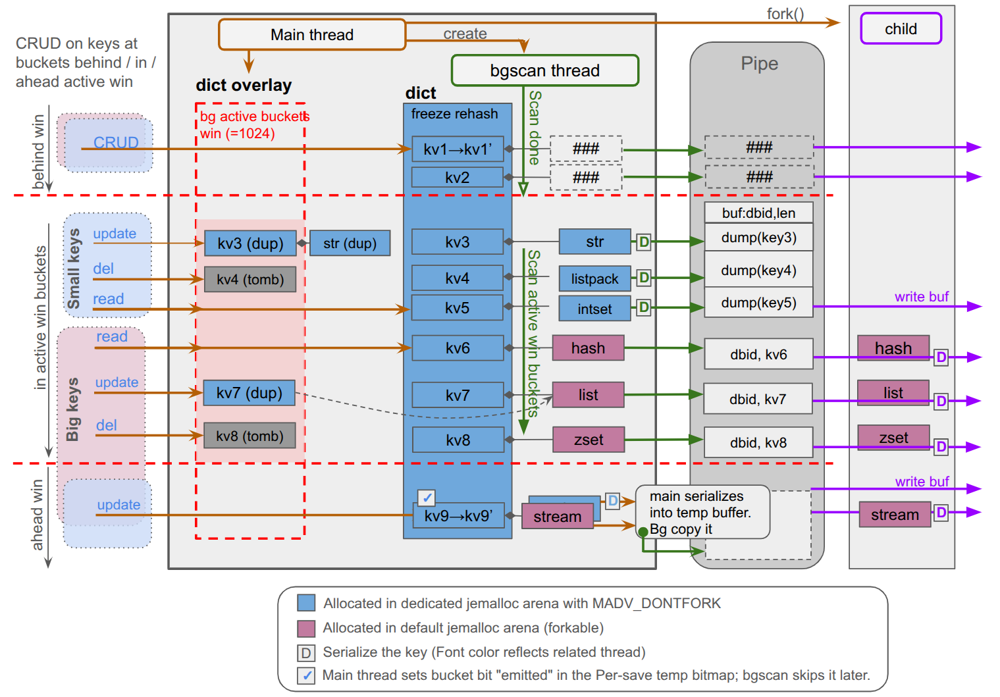

# fork() less, not forkless: Redis BGSAVE without the copy-on-write bill

*Draft, 2026-09-26. Numbers are from the snapshot-hybrid-bgsave branch (POC), measured on an
EC2 c7i.4xlarge against Redis unstable 0d6266f2d and Valkey unstable 06d35aca6. See
`utils/snap-bench/RESULTS.md` for the raw runs.*

## 1. Background: the brilliance and the bill of fork()

Redis has always taken point-in-time snapshots the simplest possible way: it calls `fork()`.
The child gets a frozen, consistent copy of the whole dataset for free, courtesy of the kernel's
copy-on-write pages, and writes it to disk while the parent keeps serving clients. No locks, no
versioning, no per-type snapshot code: every data structure, every encoding, every module type
is snapshotted by the same mechanism, because the mechanism is the address space itself.

The bill arrives in two forms, both proportional to how much memory the process maps.

**Copy-on-write memory.** Every 4 KB page the parent writes while the child is alive is
duplicated. Under write traffic a save can double resident memory, and operators size for it. In
our runs a 4 GB dataset under 50k writes/s needed 7.3 GB during a 36-second save, 3.3 GB of it
copies of pages that had just been written; a 20 GB instance provisioned with 35 GB so that a save
under load does not meet the OOM killer is not an exotic setup. The granularity makes it worse than it sounds: a 50-byte SET dirties a full
page, and so does the hash-table bucket that points at it. With transparent huge pages the unit
is 2 MB, which is why every deployment guide tells you to turn them off.

**The fork stall.** `fork()` copies the page tables, roughly 2 MB per gigabyte of resident
memory. We measured 5 ms on 300 MB and 34-40 ms on 4 GB, each one landing on whichever command
was in flight; on a 50 GB instance it is a 100 MB copy with the event loop stopped, visible as
`latest_fork_usec`. The dataset kept growing, and so did the pause.

## 2. The alternative: Valkey's forkless snapshot, and what it costs

The obvious escape is to not fork at all: walk the keyspace on a thread, serialize each key, and
make sure a key that is about to be modified is serialized first. Valkey recently landed a
forkless BGSAVE on this idea. On a dataset of small values the headline number is real: in our
measurements it added 1-2 MB of memory during a save where fork-based Redis added 100-200 MB.
That number is the whole case for forkless. The rest of this section is the bill, and none of it
is a rough edge of a first release. Once the kernel stops doing the snapshotting, every guarantee
it gave for free has to be re-earned in user space, one data structure and one code path at a
time:

- **Serialization-unfriendly encodings.** Listpacks, intsets and short strings can be copied as
  a blob; hash tables, skiplists, quicklists and streams cannot be read while they change. A
  forkless design must lock the whole key for the whole serialization or redesign every encoding.
- **Big values.** A key must be serialized atomically. For a 50-byte string that is nothing. For
  a 100 MB hash the serializer holds the key for the whole duration and any client that wants to
  write it must be blocked, or the value copied first. In Valkey the all related writers enters a blocked
  state until the key is done; a Lua script that did not declare its keys cannot be blocked that
  way and stalls the whole server instead. On our 4 GB datasets with 1M-field hashes, a write that
  landed on the hash under serialization waited 20 to 35 seconds, up to 16 clients sat blocked at
  once, and the server delivered 41% to 76% of the offered write rate for the length of the save.
- **The main thread pays.** Whatever the child no longer does, the main thread does: the
  snapshot cut, the pre-write copies, the iteration and coordination. Saving 4 GB of small values at 50k
  writes/s cost its main thread 26 CPU-seconds against 12 for the hybrid, write latency p99 was
  2-5x, and the save took 40-50% longer.
- **Remembering what was already saved.** For every key a write touches, the save must know
  whether the snapshot has passed it. Valkey keeps a generation counter in the key itself: every
  object grows by a 8-byte field for the life of the process, whether or not a save is running. 
- **Modules.** `rdb_save` used to run in a child with a consistent copy of everything. Forkless
  runs it on a background thread while the module's own commands keep mutating its values, so
  every module must certify thread safety and teach its write paths that a key open can now fail
  because the saver holds the key.

These costs follow from the decision to snapshot inside the live address space, and they are the
reason we did not take that road.

## 3. Hybrid BGSAVE: cut where the data already wants to be cut

Forkless is the right answer for small values. The trouble starts with the values it cannot serialize atomically. A
hash of a million fields is about 90 MB, and every client that writes to it while the saver holds
it waits until the whole hash is written: 20 to 35 seconds in our runs. Whether that is acceptable
depends on the data. And data changes: a keyspace that is all small values today grows one large
hash behind next quarter's feature. A snapshot mechanism should absorb that seamlessly, without
anyone having to notice which keys crossed a size line. Forkless cannot, and the decision is made
at startup: whoever discovers at 3 a.m. that a big-value workload does not suit it cannot switch
back with CONFIG SET. The server restarts, or it lives with the trade.

There is a third option: keep `fork()` for exactly the values it is good at, and keep it away
from everything else.

Look at what lives in a Redis process. The *bytes* are dominated by a few big values; the *pages*
are dominated by millions of tiny things: key-value object headers, short strings, listpack
hashes and sets, dict entries, the hash-table buckets themselves. On our small-value dataset 99%
of allocated memory is this class; on a mixed dataset about half. These are also exactly the
things that are cheap to serialize atomically: a listpack or a short string is one allocation,
and serializing it is one `memcpy`.

The hybrid splits the dataset along that line:

- **Small.** Kvobj headers, the keyspace dict tables, and every single-allocation value up to a
  size cap: strings, and the listpack or intset encodings of lists, sets, zsets and hashes, at
  most 4 KB in the POC. They live in a dedicated jemalloc arena marked `MADV_DONTFORK`; the kernel
  does not map them into the child at all, and a scan thread in the parent serializes them from
  the live dicts.
- **Big.** Everything else: hash tables, skiplists, quicklists, streams, module types, and any
  eligible encoding above the cap. They stay in the normal arena and the forked child serializes
  them exactly as today, from its copy-on-write snapshot, at the same cost as today.

The child is still the single writer of the RDB. The scan thread sends it 64 KB buffers of
pre-encoded small records; for a big key it sends a copy of the key's header, and the child
follows the value pointer into its own snapshot. The output is an ordinary RDB file.

**Consistency without locks.** The scan thread walks the hash table bucket by bucket, publishing
the window of buckets it is reading. A write to a bucket the scan has not reached yet first
serializes that bucket (a bounded memcpy per key), flips a bit in a per-save bitmap, then
proceeds in place. A write inside the window is diverted to an overlay until the window moves on.
A write behind the window is just a write. The main thread never waits, and no client is ever
blocked. The "already saved" state is one bit per bucket, about 256 KB for a 2-million-bucket
table, allocated with the save and freed with it: nothing in the object header, nothing between
saves.



*Figure 1. One hybrid save in flight. Blue memory is in the DONTFORK arena and never mapped in
the child; pink is ordinary forkable memory. The scan thread reads the frozen dict through a
window of 1024 buckets. Behind the window, writes go in place (kv1). Inside it, a write clones
the key into the overlay (kv3, kv7) or tombstones it (kv4, kv8) while the scan serializes the
fork-instant original: small values (kv3-kv5) are dumped into 64 KB buffers, big values (kv6-kv8)
travel as header copies and the child serializes them from its own copy-on-write snapshot. Ahead
of the window, the main thread serializes kv9's whole bucket into a temporary buffer, marks the
bucket "emitted" in the per-save bitmap so the scan skips it, then writes in place; the scan
thread forwards the buffer. kv8 is deleted during the save and still reaches the file: the
snapshot is the fork instant.*

**What it buys.**

- **Against fork():** the stall shrinks to the page tables of the big values, 1.6 ms instead of
  34-40 ms on 4 GB of small values, and copy-on-write for the small class is not reduced but gone,
  since its pages are not in the child: 8 MB instead of 3.3 GB in the same save. What remains is
  fork's cost on big values actually written during the save.
- **Against forkless:** nobody waits. No blocked clients, no main-thread copy of a 10 MB hash, no
  atomic-serialization requirement on hash tables or streams, no per-key field, no startup-only
  mode: `bgsave-hybrid` is a runtime switch.
- **Against both:** modules keep their contract. Callbacks run in a child, single-threaded, with
  the module's memory intact (section 5).

**Why the cut is in a natural place, and why it can move.** Redis already switches encoding at a
size threshold: a hash is a listpack until it grows, then a hash table. The listpack side is one
allocation built to be copied; the hash-table side is not. The hybrid line follows that existing
transition, so no encoding had to change to reach the numbers below. And the line is a knob, not
a constant: whenever a type gains a snapshot-friendly encoding, that class moves to the arena
side and its copy-on-write goes to zero, one type at a time.

## 4. What else stays out of the child: the keyspace itself

The size cap decides where a *value* lives. But the pages a fork child copies most are not
values. They are the two structures every command touches, whatever the value size.

**The kvobj headers**: type, encoding, LRU/LFU clock, refcount, expire, embedded key name, value
pointer. Every read and every write touches the clock, EXPIRE rewrites the expire slot, an
overwrite replaces the header. A page holds dozens of them, so modest traffic dirties header
pages faster than value pages, and under fork each is copied even when the value it points to
was never written. **The keyspace hash tables**: every write touches a bucket chain, every insert
or delete touches the table, and incremental rehashing dirties the whole table page by page. This
copy-on-write scales with the number of keys, not their size, and runs for the entire save.

In the hybrid both live in the DONTFORK arena for every key, big or small. The child never maps a
header or a table; for a big value it receives a few dozen bytes of header copy over the channel,
with a value pointer that is valid because the value is in forkable memory. Rehashing is paused
and resizing refused for the dicts under a save.

Share of allocated memory in the arena, and so never in the child, after loading each dataset:

| dataset | keys | allocated | in the DONTFORK arena | share |
|---|---|---|---|---|
| small values | 1.4 M | 302 MB | 299 MB | 99% |
| mixed | 1.2 M | 250 MB | 127 MB | 51% |
| big values | 24 | 255 MB | 0 MB | 0% |

The benefit tracks the number of keys, not the bytes: millions of keys with a few large values
get most of it even when most bytes are in the large values.

**What else a parent writes during a save.** Values and keyspace aside, the pages a parent dirties
while the child runs are its buffers: each client's reply buffer and query buffer, the reply-list
blocks of clients with pending output, the replication backlog and replica output blocks, the AOF
buffer. Each is rewritten in place, so each costs its size once per save. We measured a save under
20k writes/s with a replica attached, AOF on and 64 pipelined clients, and the child stayed at its
3 MB floor: with a few dozen clients and the default 1 MB backlog there is nothing to exclude. Two
of them scale, though. Ten thousand active connections hold 100-160 MB of reply buffers, all
dirtied during every save. And a replication backlog sized for replica disconnects, hundreds of
megabytes or more on a busy primary, is rewritten end to end when the write stream during the save
exceeds it: a gigabyte of copy-on-write per save from a single ring buffer. Neither is read by any
child, the RDB child writes a file and the diskless-sync child writes the RDB it generates, and
each is a single allocation site, so both can move into the DONTFORK arena for the price of one
allocator call and a check in the child's memory-dismissal path. That is planned and not yet
measured; until it is, the 8 MB extra of the small dataset holds for the workloads above and not
for a primary with a large backlog under heavy writes.

## 5. What it asks of modules

Nothing changes for a module on the main thread. Module values are always big-value class, so
the forked child serializes them through `rdb_save` exactly as today, single-threaded, with every
module allocation mapped. Module commands keep writing through WRITE-mode key handles; the handle
lookup is what serializes the bucket first, so in-place writes through a DMA pointer or a type
API need no new code.

The one new rule: the child has no keyspace, so a save callback that opens another key faults
instead of reading a stale copy. Save callbacks must serialize only the value they are given and
module-owned memory. We audited RedisJSON and RediSearch against this: both comply as they are.

The forkless contract asks more. The author must certify that `rdb_save` is thread-safe, and
every open of a key the command did not declare needs a new branch for a NULL handle. Both are
audits across the whole module, and Valkey requires every loaded module to complete them before
any forkless save runs; one module that has not opted in sends every save back to fork(). The
hybrid's ask is one rule in one place, because the module's code still runs where it always ran.

This is the baseline, not the ceiling. Module values are big-value class today because the hybrid
cannot see inside them, so a dataset of millions of small JSON documents or Bloom filters still
pays copy-on-write on all of them. A module type could later opt in to the small-value class: its
allocations move to the arena and the scan thread calls its `rdb_save`. That is the stronger
contract, the one forkless asks of every module up front: a thread-safe serializer, a bounded
value size, and no module code in the child. The hybrid makes it a per-type choice a module author
takes when the win is worth it, rather than the price of admission for the feature.

## 6. Replication: the same child, a different socket

Full sync is the fork nobody schedules. It runs when a replica is added or falls behind, on the
largest primaries, under live writes, and it is the usual source of the "memory doubled during
sync" incident. Nothing in the hybrid is specific to files: the child owns an output stream, and
for a disk-based sync that stream is dump.rdb, so disk-based full sync already runs through the
hybrid today. For a diskless sync the child points the same stream at the replica sockets, as the
stock child does, and the scan side does not change.

The snapshot is point in time at the fork instant, so the replication offset is the one stock
records before forking and the wire protocol is untouched: any replica version syncs from a hybrid
primary. It also composes with Redis 8's rdb-channel sync, where the child writes the RDB on a
dedicated connection while the parent streams the backlog from the snapshot offset on the main one.
That moves the stream buffer from the primary to the replica, which is loading into an otherwise
empty process, so the primary sees no copy-on-write on small values and no output-buffer growth,
with no new protocol.

The buffer still exists, on one side or the other, and it grows with write rate times sync
duration. Valkey's forkless full sync removes it with a good idea: the primary splices the
replicated commands into the RDB stream as it goes and the replica executes them while loading, so
nothing waits anywhere. For forkless this is not optional. Its snapshot is not point in time, so
the stream must carry the commands, the offset is only known at the end and travels in an extra
handshake, and a dual-channel sync falls back to fork. For the hybrid the same splice is an
optimization, and a cheaper one: the write funnel already knows, for every command, that the
fork-instant records of its keys are ahead of it in the stream, so every command from the fork
instant on is appended in order, the offset is the fork offset plus the spliced bytes, and the
only additions are one opcode and one replica capability. Replicas without it get the rdb-channel
path above.

Status: disk-based sync is running; the diskless path and the spliced stream are designed and
filed, not built or measured.

## 7. Benchmark

EC2 c7i.4xlarge, server on 4 physical cores, load generator on the other 4, dumps on tmpfs.
Datasets of about 4 GB (18.9-19.5 M keys, or 68 keys for the big one), each loaded from the same
RDB for every configuration. Writes at 20k and 50k ops/s, uniform over the keyspace or on a 20%
hot set, running before, during and after the save; two repeats per cell, medians shown.
"Peak" is parent RSS plus the fork child's private dirty pages, the memory the machine must have;
"extra" is peak minus the parent's RSS before the save. Write latency is per pipelined batch as
seen by the load generator. The 300 MB runs that preceded these tell the same story at a tenth
of the scale and are in the repository.

### Small values (4.1 GB, 18.9 M keys: 100-byte strings and 10-field listpack hashes)

| writes/s | config | save s | fork stall ms | peak MB | extra MB | main CPU s | PING max ms | write p99 ms | write max ms |
|---|---|---|---|---|---|---|---|---|---|
| idle | Redis (fork) | 33.8 | 34 | 4109 | 2 | 0.5 | 31.3 | | |
| idle | hybrid | 31.3 | 1.6 | 4030 | 2 | 0.4 | 1.8 | | |
| idle | Valkey forkless | 36.1 | 0 | 3911 | 0.5 | 10.7 | 1.7 | | |
| 20k | Redis (fork) | 35.1 | 34 | 6408 | 2380 | 7.7 | 30.0 | 0.60 | 34.5 |
| 20k | hybrid | 31.5 | 1.6 | 4036 | 8 | 6.9 | 1.0 | 0.63 | 2.5 |
| 20k | Valkey forkless | 46.0 | 0 | 3904 | 9 | 17.2 | 1.7 | 3.41 | 7.0 |
| 50k | Redis (fork) | 35.6 | 38 | 7334 | 3306 | 13.9 | 36.1 | 0.45 | 39.5 |
| 50k | hybrid | 29.3 | 1.6 | 4036 | 8 | 11.8 | 1.4 | 0.49 | 3.1 |
| 50k | Valkey forkless | 41.9 | 0 | 3916 | 21 | 25.6 | 2.7 | 1.25 | 4.5 |
| 50k, 20% hot | Redis (fork) | 35.3 | 40 | 6910 | 2882 | 14.5 | 38.4 | 0.33 | 41.3 |
| 50k, 20% hot | hybrid | 29.7 | 1.6 | 4036 | 8 | 12.8 | 1.2 | 0.31 | 3.6 |
| 50k, 20% hot | Valkey forkless | 41.0 | 0 | 3906 | 12 | 23.5 | 2.6 | 1.12 | 4.9 |

To save 4 GB under 50k writes/s, stock Redis needs 7.3 GB: it copies 3.3 GB, over 80% of the
dataset, in 36 seconds, and its 38 ms fork stall is the worst PING and the worst write of the
run. The hybrid needs 4.0 GB, 8 MB more than it had, stalls for 1.6 ms, and finishes 6 seconds
sooner. Forkless also holds memory, at 9-21 MB, but its save is 40-50% longer than ours, its main
thread burns twice the CPU, and every write is 2-5x slower at p99. Nobody misses the offered rate
on this dataset.

### Mixed (4.0 GB, 19.5 M keys: 45% of bytes in small values, 55% in 256k hash-table hashes of 9 KB)

| writes/s | config | save s | fork stall ms | peak MB | extra MB | main CPU s | achieved/s | write p99 ms | write max ms |
|---|---|---|---|---|---|---|---|---|---|
| idle | Redis (fork) | 36.9 | 37 | 3979 | 2.5 | 0.5 | | | |
| idle | hybrid | 18.7 | 17 | 3909 | 2 | 0.3 | | | |
| idle | Valkey forkless | 40.3 | 0 | 3900 | 1 | 11.0 | | | |
| 20k | Redis (fork) | 36.0 | 38 | 6223 | 2324 | 8.4 | 19995 | 0.63 | 39.1 |
| 20k | hybrid | 23.3 | 19 | 4772 | 852 | 5.8 | 20000 | 0.65 | 20.1 |
| 20k | Valkey forkless | 44.1 | 0 | 3828 | 7 | 15.8 | 18970 (95%) | 7.1 | 13.7 |
| 50k | Redis (fork) | 37.4 | 42 | 7058 | 3148 | 14.8 | 49981 | 0.50 | 43.6 |
| 50k | hybrid | 31.3 | 18 | 5492 | 1576 | 14.3 | 49995 | 0.40 | 20.9 |
| 50k | Valkey forkless | 44.4 | 0 | 3861 | 16 | 23.6 | 46490 (93%) | 12.6 | 17.6 |
| 50k, 20% hot | Redis (fork) | 36.0 | 43 | 5899 | 1988 | 14.8 | 49982 | 0.32 | 44.5 |
| 50k, 20% hot | hybrid | 21.8 | 19 | 4416 | 506 | 9.6 | 49996 | 0.33 | 20.8 |
| 50k, 20% hot | Valkey forkless | 45.3 | 0 | 3827 | 14 | 26.3 | 49203 | 0.91 | 16.9 |

This is where the trade-off is visible. The 9 KB hashes have 96-byte field values, above Redis's
64-byte `hash-max-listpack-value`, so they are hash tables, and a hash table is fork-class at any
size. They pay copy-on-write when written: 0.5-1.6 GB for the hybrid against 2.0-3.1 GB for stock,
with the stall halved and the save shortest in every cell, half of stock's when idle because the
scan thread and the child work in parallel. Forkless pays nothing in memory for them, but its main
thread works 1.6-2.7x harder, write p99 is 7-13 ms against 0.4-0.65, its saves are the longest,
and at 20k and 50k it is the only configuration that cannot keep up. The rest of the hybrid's gap
is the encoding line moving: keep these hashes listpack-encoded (`hash-max-listpack-value 128`,
cap 16 KB) and they join the small class with no code change; or admit small hash tables to the
arena, which is code. Either brings this dataset toward the small one's 8 MB. Neither is measured
yet.

### Hashes of a million fields (mixed1m: 19.2 M small keys plus 24 hashes of 1M fields; big1m: 36 such hashes and 32 sorted sets)

| dataset | writes/s | config | save s | fork stall ms | peak MB | extra MB | achieved/s | write p99 ms | write max ms | stalled s |
|---|---|---|---|---|---|---|---|---|---|---|
| mixed1m | 20k | Redis (fork) | 43.0 | 30 | 6567 | 2494 | 19997 | 0.64 | 31 | 0 |
| mixed1m | 20k | hybrid | 41.3 | 17 | 5324 | 1251 | 19999 | 0.65 | 19 | 0 |
| mixed1m | 20k | Valkey forkless | 48.2 | 0 | 4011 | 4 | 15045 (75%) | 1.48 | 22,566 | 6-7 |
| mixed1m | 50k | Redis (fork) | 43.4 | 31-41 | 7325 | 3252 | 49988 | 0.39 | 32-42 | 0 |
| mixed1m | 50k | hybrid | 40.7 | 15-16 | 5813 | 1740 | 49999 | 0.38 | 17 | 0 |
| mixed1m | 50k | Valkey forkless | 45.6 | 0 | 4015 | 8 | 38125 (76%) | 1.41 | 21,745 | 10-11 |
| big1m | 20k | Redis (fork) | 34.2 | 30-34 | 5749 | 1901 | 19995 | 0.67 | 30-36 | 0 |
| big1m | 20k | hybrid | 35.6 | 26 | 5795 | 1946 | 19996 | 0.68 | 27 | 0 |
| big1m | 20k | Valkey forkless | 34.7 | 0 | 3754 | 1 | 8532 (43%) | 0.64 | 33,946 | 5-7 |
| big1m | 50k | Redis (fork) | 35.9 | 27-36 | 6690 | 2842 | 49982 | 0.32 | 28-37 | 0 |
| big1m | 50k | hybrid | 35.2 | 27-30 | 6679 | 2830 | 49985 | 0.32 | 29-32 | 0 |
| big1m | 50k | Valkey forkless | 34.9 | 0 | 3754 | 0-1 | 20743 (41%) | 0.32 | 34,148 | 9-10 |

Two things happen here. On big1m, where every byte is fork-class, the hybrid and stock are the
same save on every column, as designed: nothing eligible, nothing gained, nothing lost, no mode
to switch. On mixed1m the hybrid again pays copy-on-write for the hashes alone, half of stock's,
with half the stall.

And forkless meets the value it cannot serialize atomically. A write that lands on the hash
being saved waits until the whole 90 MB hash is written: 22 to 34 seconds at worst, up to 16
clients blocked at once, and 41% to 76% of the offered rate delivered for the length of the save.
The p99 column hides it, since the blocked writes are few; the achieved rate and the maximum do
not. This is not a tuning problem. It is what "serialize each key atomically" means when a key is
a million fields.

### One core (mixed, 4 GB, server and all its threads and children pinned to a single vCPU)

| writes/s | config | save s | fork stall ms | extra MB | achieved/s | write p99 ms | write max ms | stalled s |
|---|---|---|---|---|---|---|---|---|
| idle | Redis (fork) | 39.8 | 32-41 | 1-4 | | | | |
| idle | hybrid | 42.0 | 17-19 | 1-2 | | | | |
| idle | Valkey forkless | 49.5 | 0 | 1 | | | | |
| 20k | Redis (fork) | 51.7 | 35-59 | 2708 | 19993 | 3.1 | 36-60 | 0 |
| 20k | hybrid | 48.5 | 30-32 | 1317 | 19996 | 4.0 | 32-33 | 0 |
| 20k | Valkey forkless | 58.0 | 0 | 8 | 17605 (88%) | 12.0 | 24 | 32-33 |
| 50k | Redis (fork) | 62.9 | 46-64 | 3311 | 49975 | 3.7 | 48-66 | 0 |
| 50k | hybrid | 63.2 | 27-33 | 1773 | 49986 | 3.2 | 29-35 | 0 |
| 50k | Valkey forkless | 63.3 | 0 | 25 | 44131 (88%) | 18.4 | 162-165 | 32-35 |
| 50k, 20% hot | Redis (fork) | 62.4 | 43-66 | 2061 | 49975 | 3.7 | 46-68 | 0 |
| 50k, 20% hot | hybrid | 55.9 | 19-23 | 532 | 49992 | 4.7 | 21-26 | 0 |
| 50k, 20% hot | Valkey forkless | 66.2 | 0 | 15 | 48650 (97%) | 7.0 | 25-28 | 6 |

The shape of a one-vCPU container. Two things change for the hybrid and one does not. The scan
thread and the child now take turns on the core instead of overlapping, so our save-time win on
this dataset is gone: 42 s idle against stock's 40, within noise under traffic. The scan thread
also competes with the main thread for the core, which costs about a millisecond at the write p99
when the main thread is lightly loaded, 4.0 against 3.1 ms at 20k; at 50k the order flips, since
stock's child copying 3.3 GB of pages takes more of the core than our scan thread does. What does
not change is memory and the stall: still half of stock's copy-on-write and half its fork stall,
because neither depends on how many cores there are.

Forkless does not survive one core at this size. Its main thread owns the serialization and the
commands, so it delivers 88% of the offered rate at 20k and at 50k, stalls writers for 32 to 35 of
the save's 60 seconds, and posts a 165 ms worst write. Its PING p99 looks best of the three, at
2.4 to 2.9 ms, because blocked writers do not answer pings.

**Steady state.** With the feature on and no save running, the instruction count per SET is
+0.01% and per GET +0.9% (callgrind): the cost of placing new values in the right arena.

## 8. Turning it on

```
redis-cli CONFIG SET bgsave-hybrid yes
redis-cli BGSAVE
redis-cli INFO persistence | grep -E "snap_saves|snap_save_keys_(nofork|fork)|snap_save_retained_bytes|snap_hard_mark_aborts"
redis-cli INFO memory | grep allocator_allocated_nofork
```

One runtime switch. Turning it on changes where *new* values and headers are placed; turning it
off makes the next save an ordinary fork save. `rdb_bgsave_in_progress`, `rdb_last_bgsave_status`
and `stop-writes-on-bgsave-error` behave as before, since a child still writes the RDB. Two knobs:
`save-small-max-bytes` (default 4 KB) is the size line within the eligible encodings, and
`bgsave-hybrid-max-retained-bytes` (default 256 MB) bounds the memory a save may hold for buckets
under the scan window before it is aborted and reported as failed. `allocator_allocated_nofork`
tells you, before any save, how much of your dataset the child will never see.

## 9. Where it stands

A proof of concept on a branch, measured at 4 GB on one host type. Before extrapolating:

- **The arena needs 64-bit Linux with jemalloc.** It is a 64 GB to 16 TB address-space
  reservation, impossible in a 32-bit process. Elsewhere the hybrid runs without the arena:
  same scan, same child, values copied on clone, no memory benefit. The 32-bit build and its
  test suite pass in that mode.

- **Diskless full sync and AOF rewrite** still take the stock fork path automatically; they
  work, they do not benefit yet. Disk-based full sync already runs through the hybrid (section 6).
- **Cluster mode** runs, but the bucket window has not been extended to per-slot dicts.
- **FLUSHDB, SWAPDB and DEBUG RELOAD** during a hybrid save abort it, as in Valkey's forkless
  save; detaching the frozen keyspace instead is designed, not built.
- **The module opt-in flag** is specified, not implemented; the per-type opt-in to the
  small-value class (section 5) is a design sketch only. The 4 KB cap and the encoding
  thresholds that feed it are untuned; the mixed dataset is the experiment.
- **The scan thread** costs about one CPU-second per 260 MB save, on a core the fork child would
  otherwise have used.
- **Save time does not yet always benefit from the two workers.** With a few huge fork-class
  values, the child's serialization of one value holds the pipe and the scan thread waits on it,
  so on mixed1m the save took 41 s where the two halves overlapped would take about 24. The fix is
  a bounded in-memory queue in front of the pipe, filed, not built.

## 10. Conclusion

Fork-based snapshots are the right tool for large values, module types and every encoding that
was never designed to be read while written. Their cost is applying the same mechanism to
millions of tiny objects where it is pure overhead. Forkless fixes that overhead by moving all
the work to the main thread, and inherits the problems of large values, blocked clients,
encodings and modules in return, plus a permanent field in every key.

The hybrid takes the split Redis's own encodings already suggest. Small values and all the
metadata around them stay out of the child and stream from a scan thread with no locks and no
blocked clients; everything else forks as before. On small-value data the copy-on-write and the
stall are gone; on mixed data they are halved and bounded by the big values alone; on big-value
data nothing changes. The command path stays at stock cost, modules keep their contract, and the
line between the halves can move as encodings evolve, one type at a time.

| | legacy fork() | Valkey forkless | hybrid |
|---|---|---|---|
| Peak memory during a save | up to 2x: 7.3 GB to save 4 GB at 50k writes/s | baseline, plus a permanent per-key field | baseline plus copy-on-write on written big values only: 4.0 GB for the same save |
| Main-thread pause at start | page-table copy: 34-40 ms on 4 GB | none | page tables of big values only: 1.6 ms on 4 GB of small values |
| Write latency during a save | page fault per first-written page; the stall lands on one write | client blocked until the key is serialized: 20-35 s on 1M-field hashes | microseconds per first write to a bucket; never blocked |
| Main-thread CPU during a save | none | the whole serialization: 1.6-2.7x | written buckets only: at or below fork |
| Big values | copy-on-write per page | client blocked or value copied | as fork |
| Modules | transparent | opt in; thread-safe serializers; NULL-handle branches | opt in; save callbacks must not read the keyspace |
| Full sync | fork: copy-on-write plus the stream buffer | commands spliced into the RDB, required; new capability; offset sent at the end; no dual-channel | stock protocol, rdb-channel compatible; the same splice as an option with no offset handshake; diskless path pending |
| Per-key state | none | 4 bytes declared, 8 in practice, always | one bit per bucket, per save |
| Switching | n/a | startup flag | runtime |
