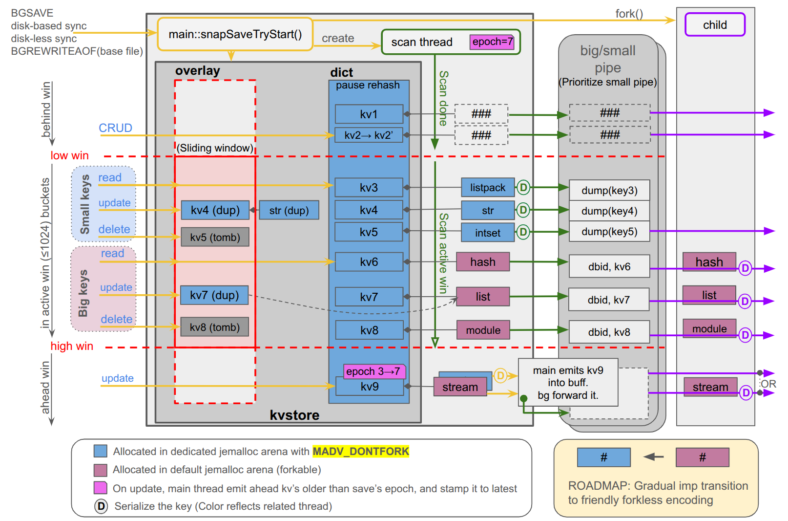

# Hybrid snapshot

Hybrid snapshot is a `fork()`-based snapshot that keeps the fork for the values it is good at and
keeps everything else out of the child. This document describes the design as implemented, for
a reader who knows Redis internals (kvstore, dict, rdb.c, the fork child) but has not seen this
code. It is the reference; `src/snapshot.c` carries a shorter overview in its file header and
`poc-hybrid-bgsave-spec.md` is the design history.

Contents: 1 problem and classes, 2 one save end to end, 3 the write funnel and the side table,
4 memory model and bounds, 5 entry points, 6 interactions, 7 module contract, 8 observability,
9 glossary, 10 invariants.

## 1. Problem and the two classes

Stock BGSAVE forks and the child serializes the whole keyspace from its copy-on-write snapshot
while the parent serves writes. Two costs scale with the dataset: the `fork()` page-table copy,
a stall on the main thread, and copy-on-write amplification, where a write of a few bytes
duplicates the whole 4 KB page it shares with unrelated neighbours, so that a long save under
writes multiplies into gigabytes of extra RSS.

The hybrid splits every key's **value** into one of two classes:

| class | what | where it lives | who serializes it |
|---|---|---|---|
| SNAP_NOFORK | every kvobj header; the keyspace and expires hash tables; single-allocation values up to `save-small-max-bytes` (default 4096): strings, listpack, intset, listpackEx | the SNAP_NOFORK arena, a jemalloc arena whose extents carry `MADV_DONTFORK`; the child never maps it | a scan thread in the parent, reading the live memory |
| SNAP_FORK | multi-allocation encodings (hash table, skiplist, quicklist, stream), module types, template hashes, any eligible encoding above the cap, any key with module key metadata | the default arena, forkable | the fork child, from its copy-on-write snapshot, exactly as stock |

Because headers and tables are in the arena, the child cannot walk the keyspace at all. It is a
serializer of SNAP_FORK values and the single writer of the output. The scan thread serializes
SNAP_NOFORK values itself and ships SNAP_FORK keys to the child as copies of their headers; the
child follows the value pointer into its own snapshot.

The class boundary follows an existing one: Redis already switches a hash from a listpack to a
hash table at a size threshold, and the listpack side is one allocation built to be copied. The
cap is a knob (`save-small-max-bytes`); the encoding list is `snapEncodingIsNoforkClass()`.

**Placement.** The class is applied to the value allocation when a key is inserted (`kvobjSet`,
`dbSetValue`), after an in-place growth of a string, and after an encoding conversion produced a
single-allocation value (`snapPlaceValue`). A value that crosses the cap or converts to a
multi-allocation encoding is moved out of the arena; a listpack adopted as the first node of a
quicklist is detached from the arena first. Only the value moves; the header, and every pointer
to it, stays. `DEBUG SNAP-PLACEMENT` and `DEBUG SNAP-DRIFT` report where values are versus where
their class says they should be.

**The arena.** One address range (16 TB on 64-bit) reserved at startup, `MADV_DONTFORK` applied in
the extent hooks on allocation and recommit. Allocation goes through `zmalloc_nofork*` with
`MALLOCX_ARENA` and a per-thread explicit tcache; `zfree()` and `zrealloc()` recognise arena
blocks by address range, so no caller needs to know the class to free. The arena exists whenever
the platform supports it (64-bit Linux, jemalloc) so the switch can change at runtime; while
`hybrid-snapshot` is off it is forkable and nothing new is placed in it. Without an arena (other
platforms, `MALLOC=libc`) the hybrid still runs, with the class as a pure size decision and the
child mapping everything; only the memory win is lost.

## 2. One save, end to end

Three parties: the **main thread**, the **scan thread** (one per save, started after the fork)
and the **child**. The scan thread and the main thread share the keyspace; the child shares
nothing but the two pipes, a `MAP_SHARED` page and its copy-on-write view of the forkable
memory.

| step | main thread | scan thread | child |
|---|---|---|---|
| 1 | Capture per-db (and per-slot) key and expire counts for `RESIZEDB` / `SLOT_INFO`. | | |
| 2 | **Freeze**: for every non-empty keyspace dict take one reference, stamp it `(generation, PENDING)` and record it in the save's table; install the store's snapshot guard. Nothing is paused, nothing allocated per dict. | | |
| 3 | `redisFork()`. The arena stays `MADV_DONTFORK`. | | Inherits the SNAP_FORK values (copy-on-write), the forkable half of the server, no headers, no tables, no small values. Reserves the arena's address range `PROT_NONE` so its own mappings cannot land there. |
| 4 | Start the scan thread; register the completion notifier with the event loop. Serve commands: every keyspace write goes through the funnel (section 3). | Walk the save's table of dicts. For each dict: publish a window of `W` buckets (default 1024), **quiesce** (wait for an open write section to close), read the window's chains with atomic loads, skipping buckets whose bitmap bit is set. SNAP_NOFORK keys are serialized into a 64 KB staging buffer; SNAP_FORK keys become KVOBJ messages. At each window boundary forward what the main thread queued. | Write the RDB header (or the AOF prologue). Then loop: take the small channel while the parent reports at least 1 MB of small backlog, waiting up to 20 ms for it to reach the pipe; otherwise take one big value. A BUFFER whose dependency (`robj_off`: big values that must precede it) is unmet is held until they are written. Track `SELECTDB` / `RESIZEDB` / `SLOT_INFO` (or `SELECT`) per message. |
| 5 | Drain side tables at the end of every write section and once per cron tick: entries whose bucket is now behind the window are applied to the dict. Complete slots the thread published as SCANNED: apply what is left, resume layout changes, free the bitmaps, mark DONE, drop the reference. Abort at the hard mark. | When a dict is fully read publish SCANNED. When all are read, publish the empty window, quiesce once more, drain the queue a last time, send END with both channels' message counts. | Finish when both counts are consumed: footer, fsync, rename (or the EOF mark on the sockets). Exit. |
| 6 | `checkChildrenDone` -> the stock done handler -> `snapOnChildEnd`: abort the scan if the child failed or the scan is unfinished, join the thread, release every remaining state, publish the last-save peaks. | Joined. | Reaped. |



*Blue memory is the arena, never mapped in the child; pink is forkable. The scan thread reads
the frozen dict through a window. Behind the window writes go in place (kv1). Inside it a write
clones the key into the side table (kv3, kv7) or tombstones it (kv4, kv8) while the scan reads the
fork-instant original: small values (kv3-kv5) go into 64 KB buffers, big values (kv6-kv8) travel
as header copies and the child serializes them from its own snapshot. Ahead of the window the
main thread serializes kv9's whole bucket into a buffer, marks the bucket emitted so the scan
skips it, then writes in place. kv8 is deleted during the save and still reaches the file.*

**Queues and channels.**

```
 main thread                           scan thread                              child
 ───────────                           ───────────                              ─────
 emit-ahead: serialize a bucket        staging buffer (64 KB) ──┐
   into mstage ──► mq ─────────────────► forwarded at window     │
   (mutex, taken by the thread          boundaries               ▼
    at window boundaries)                                 oq: small-channel queue ──► pipe A (BUFFER) ──► small-first loop
                                                                                        shared page: bytes queued on oq
 SNAP_FORK key written ahead:                                                             (child reads it to choose)
   header copy ──► mq ─────────────────► bq: big-channel queue ──► pipe B (KVOBJ, END, ABORT) ──► one big value at a time
                                        one bound over oq + bq:
                                        hybrid-snapshot-max-queued-bytes
                                        (the thread waits past it)
```

Both pipes are written non-blockingly from the scan thread's queues, so a child busy inside one
large value never stalls the scan. The main thread's queue `mq` is the only place the main thread
and the scan thread meet under a mutex, and the thread takes it only at window boundaries.

**Replication offset.** The snapshot is point in time at the fork instant, so the offset is the
one stock records before forking; the wire protocol and the RDB format are unchanged, and any
replica version loads a hybrid dump.

## 3. The write funnel and the side table

Every keyspace write to a frozen dict goes through the kvstore overlay's `prepare` hook before it
touches the dict. Reads go through the overlay too, so a key with a pending clone or tombstone is
read from the side table first. Inside a **write section**, opened at the first such hook of a
command and closed when the outermost command returns, at `beforeSleep` and when a module thread
releases the GIL, the main thread derives the key's `(table, bucket)` and compares it with the
dict's state and the published window:

| position | condition | action |
|---|---|---|
| behind | dict SCANNED or DONE, or same dict and `(table, bucket)` before the window | write in place; nothing is owed |
| emitted | the bucket's bitmap bit is set, whatever the position | write in place; the thread skips the bucket |
| inside | same dict, same table, `lo <= bucket < hi`, bit clear | never touch the chain: clone the key into the side table on first touch and apply the write to the clone; a delete leaves a tombstone; an add lands in the side table |
| ahead | dict PENDING, window on another dict or table, or `(table, bucket)` after the window, bit clear | **emit first**: serialize the bucket's whole fork-instant chain on the main thread (SNAP_NOFORK records into the staging area, SNAP_FORK keys as header copies) into `mq`, set the bit, then write in place |

**Why it is race-free.** The thread reads chain pointers only inside its window; the main thread
writes chains only outside the window and only inside a section, which the thread cannot
overtake: after publishing a window the thread waits for an open section to close, and a section
that starts afterwards sees the new window (both sides store then load with seq_cst). A bucket's
bit is set only while the bucket is ahead of the window and read only while it is inside, so the
two never touch one bit at once. Value mutations that do not go through the hook (`APPEND`,
`INCR`, `HSET` on a listpack) need no protection: their bucket was emitted or walked before the
command ran and the thread never returns to a bucket. The scan thread never blocks the main
thread; the main thread blocks the scan thread for at most one command.

**Attach and pause.** A dict acquires its per-save state on demand: the store's guard, which runs
on every access to a dict without an overlay while the scan runs, attaches on the first
structural write, or on any access while the window is on the dict. Attaching allocates one
bitmap per hash table and the overlay. Only the dict under the window has its rehashing and
auto-resize paused. An attached dict the thread has not reached may keep growing: when it starts
a rehash the bitmap of the old table is replicated into the new one (bucket `i` of `n` becomes
`i + j*n` of `k*n`), and emit-ahead on such a dict marks the whole bucket class in both tables.
A shrink merges buckets, which a bitmap cannot follow, so it is refused for attached dicts.

**The side table.** A fixed array of 1024 slots of chains of ordinary dict entries, a key's slot
being its hash modulo 1024, allocated on the first deferred write of a dict and freed with the
overlay, so only the dict under the window carries one (32 KB). Four chains per slot encode the
entry's state without a per-entry flag: LIVE (deep clones and adds), SHARED (clones whose value
allocation is still the original's), TOMB and TOMB_SHARED. A key is in at most one chain, a
position in a chain is an ordinary `dictEntryLink`, and the links handed to callers need no
translation.

**Clone.** A clone copies the whole kvobj allocation into a fresh arena block. A SNAP_NOFORK value
is deep-copied; a SNAP_FORK value is shared with the original, since the child already has its
own copy. The clone takes over the key's entry in `db->expires` and, for a hash with field TTLs,
the registration in the db's sub-expiry buckets: the original's `ExpireMeta` is trashed, which is
why anything that serializes a fork-instant original must read field TTLs from the value, not
from the registered metadata.

**Drain and release.** An entry stays in the side table only while the thread may still read its
bucket. At the end of every write section and once per cron tick the main thread applies every
entry whose bucket is behind the window: a clone replaces its original at the link and the
original is freed, a tombstoned original is unlinked and freed, an add is inserted. The drain
swaps the dict's type pointer to a private copy for its duration, so that freeing the originals
does not go through the store's shared destructor while the lazyfree thread may be releasing a
sibling dict with the same type. When the thread publishes SCANNED for a dict, the main thread
applies what is left, resumes rehashing and auto-resize, frees the bitmaps, marks the dict DONE
and drops the save's reference. From then on writes to it are stock writes.

**References.** A dict is owned by its store (one reference) and held by a running save (one
more, taken at freeze). A store that frees, empties or moves a dict another holder references
detaches it instead: the dict leaves the slot table and the store's bookkeeping, keeps its save
state, and is freed by the last holder. Every dict holds a reference on its store, so a store
released on the lazyfree thread outlives its detached dicts. This is what lets FLUSHDB, an atomic
slot migration's trim and a kvstore release run while the save still reads the dict. A generation
stamp on every dict the save touched identifies its own state; because the save releases every
state it attached before its guard comes off, no state can outlive its save and no leftover
handling exists.

## 4. Memory model and bounds

What a hybrid save holds beyond the dataset, and what bounds it:

| memory | where | bound |
|---|---|---|
| copy-on-write on SNAP_FORK values written during the save | child, kernel | the forkable memory: `allocator_active` minus `allocator_active_nofork`, reached only if every forkable page is written |
| child page tables | child | proportional to the forkable range; sets the fork stall |
| retained originals: fork-instant SNAP_NOFORK values kept alive by side-table clones and tombstones while their bucket is inside the window | parent | released as the window moves on |
| emit-ahead records queued by the main thread (`mq`) | parent | forwarded at the next window boundary |
| the scan thread's queues to the child (`oq` + `bq`) | parent | `hybrid-snapshot-max-queued-bytes` (default 100 MB): past it the thread waits for the child, never aborts |
| per-dict bitmaps and side tables | parent | one bit per bucket per table of attached dicts; 32 KB side table for the dict under the window |

The **hard mark**, `hybrid-snapshot-max-retained-bytes` (default 256 MB, 0 unlimited), covers the
retained originals plus the bytes the main thread has queued and the thread has not yet handed to
its own queues. `snapSaveCron` aborts the save when it is exceeded, and reports the save as failed
(`rdb_last_bgsave_status:err`, `snap_hard_mark_aborts`). The worst-case memory a save holds in the
parent is the sum of the two bounds. The queues, the retained originals, the bitmaps and the save's
fixed bookkeeping (per-slot size tables, dict tables, completion ring) are excluded from the eviction
calculation, like the replication buffers, so a save never causes evictions by itself: that memory
is what stock's child would hold in its own process.

The small channel policy keeps the queue small in practice: the child drains the small backlog
before each big value, so the queue peaks at about one big value's worth of scan output. A single
value longer than `bound / scan rate` parks the thread for the remainder of that value.

## 5. Entry points

Every consumer of a fork-based snapshot goes through the same dispatch rule: `hybrid-snapshot` on,
the request has keyspace content, and every loaded module with save callbacks has opted in
(section 7). Otherwise the stock child runs and `redisFork` flips the arena to `MADV_DOFORK` for
that child's lifetime, flipping it back when no child of any kind is left; such a child pays stock
copy-on-write on the arena.

| entry point | path with the hybrid on | notes |
|---|---|---|
| BGSAVE, save points, BGSAVE SCHEDULE | hybrid, RDB child, `dump.rdb` | the previous dump is untouched until the rename |
| SAVE, DEBUG RELOAD's save, SHUTDOWN's save, FLUSHALL with save points | foreground `rdbSave` in the parent | the parent maps everything, so the stock serializer works unchanged |
| disk-based full sync | hybrid, via `rdbSaveBackground` | the file is then streamed as today |
| diskless full sync, rdb channel | hybrid; the child writes the replicas' sockets | several replicas share one child; the replication stream buffers on the replica |
| diskless full sync, one connection | hybrid; the child writes a pipe, the parent relays it | about 2 CPU-seconds of relay per 4 GB on the main thread |
| functions-only transfer | stock child | no keyspace content |
| atomic slot migration's slot snapshot | hybrid over the migrating slots only; the child writes the rdb-channel connection | a third record form: the stream is RESP (`FUNCTION RESTORE`, `SELECT`, `CLUSTER SYNCSLOTS CONF SLOT-INFO` once per slot, `RESTORE ... ABSTTL` from a `DUMP` payload per key, `CLUSTER SYNCSLOTS SNAPSHOT-EOF`), written by the same producers through `slotSnapshotSaveKeyValuePair`; only the migrating slots' dicts are frozen and scanned (`snapScanSetSlotFilter`), writes to every other slot are plain writes; the child never maps the arena, so the migration pays the fork-class page tables and fork-class copy-on-write, as a hybrid BGSAVE does |
| BGREWRITEAOF, `aof-use-rdb-preamble yes` | hybrid, AOF child, RDB base file | the INCR file opens before the freeze, so the fork instant is where its history starts |
| BGREWRITEAOF, `aof-use-rdb-preamble no` | hybrid, AOF child, command-form base file | the same producers call `rewriteObject` per record; the child writes the AOF prologue and emits `SELECT` only on a db change |
| BACKUP | through BGREWRITEAOF | |
| `RedisModule_Fork`, Lua debugger fork | stock child, arena flipped | |
| `CONFIG SET hybrid-snapshot` | flips the arena | refused while any child or hybrid save runs |

Mutual exclusion is the existing one-child rule. A BGSAVE issued while a stock child runs is
scheduled and starts, on the hybrid path, after the flip back.

## 6. Interactions

What happens when something else touches the keyspace or the child during a hybrid save.

| event | behaviour | same as stock? |
|---|---|---|
| FLUSHALL (sync or ASYNC) | the dbs are handed to the save, then the caller's `killRDBChild` ends it; the next save works | yes, stock kills the RDB child there |
| FLUSHDB | the db gets fresh empty structures at once; the fork-instant ones stay with the save and are freed on BIO when the store completes; the dump holds the fork instant | stock's child keeps its copy |
| SWAPDB | the save scans kvstores, not db ids: keys stay under their fork-instant db id, writes through the new id take the funnel | yes |
| DEBUG RELOAD, DEBUG LOADAOF, CLUSTER RESET HARD, `RedisModule_ResetDataset` | every db is handed to the save, which finishes with the fork-instant data | yes |
| a replica's full-sync load | the replica's own running save is ended by its `killRDBChild` before the load | yes |
| hybrid AOF rewrite and FLUSHALL | the rewrite finishes on the detached dbs; the FLUSHALL lands in the INCR file | yes, stock keeps its AOF child |
| atomic slot migration's slot snapshot | start, success, failure and cancel run through replication's hooks into the migration's state machine (`asmSlotSnapshotAndStreamStart`, `asmSlotSnapshotSucceed`, `asmSlotSnapshotFailed`, `killRDBChild` on cancel), the same path a hybrid full sync takes; the slot set is fixed at the fork instant from the migrate task, like the trim set below | yes |
| atomic slot migration's trim | keys of slots under a trim job at the fork instant are skipped and counted in the "keys skipped" log line, as stock's child skips them; a trim that starts during the save is not in that set, its moved slot dicts stay with the save (references), are serialized to the end and freed when their slots complete | yes |
| rehash and resize | the dict under the window is paused; unreached dicts grow with their bitmap, shrink is refused for attached dicts | stock avoids resizing while a child exists |
| active defrag | off while a child exists (stock rule); the arena's tcache is flushed once a second by cron | yes |
| key expiry and eviction | active expiry and eviction continue; deletes go through the funnel; LRU/LFU updates on lookups are skipped while a child exists | yes |
| hash-field expiry | active field expiry is suspended for the save; lazy field expiry and `HRANDFIELD` skip deletion on owed keys (expired fields are invisible, not deleted, as on a replica) | hybrid-specific |
| `RM_SetLRU` / `RM_SetLFU` on a READ handle | routed through the write funnel first | hybrid-specific |
| `PFCOUNT` cache write on an owed key | re-enters through the write path | hybrid-specific |
| SHUTDOWN | kills the child; the hybrid abort runs through `killRDBChild` | yes |
| child killed or crashed | the done handler aborts the scan, joins the thread, releases every state; the previous dump is untouched; a child crash report skips the keyspace sections it cannot read | yes |
| hard mark exceeded | the save is aborted and reported as failed | hybrid-specific |
| `CONFIG SET hybrid-snapshot` | refused while a child or save runs | hybrid-specific |

## 7. Module contract

Module code never runs on the scan thread: module values and every key with module key metadata
are SNAP_FORK, serialized by the child from the header copy through the type's `rdb_save` and the
metadata save callbacks, as stock does. `aux_save` runs in the child from the RDB header.
Persistence events fire where stock fires them. Module allocations are forkable and mapped in the
child.

The one difference from stock: **the hybrid child has no keyspace.** Dict tables, headers other
than the copy handed to the callback, and small values are unmapped there.

A module is compatible with `hybrid-snapshot yes` when:

1. Its save-side callbacks (`rdb_save`, `aux_save`, `aux_save2`, key-metadata save, a PERSISTENCE
   event handler) do not touch the keyspace: no `RM_OpenKey`, `RM_KeyExists`, `RM_Scan`,
   `RM_ScanKey`, `RM_Call`, `RM_DbSize`, `RM_RandomKey`, `RM_GetExpire` on any key. Allowed: the
   value passed to the callback, module-owned memory, the IO context.
2. Module-owned state does not keep pointers into Redis-owned key memory (`RM_StringDMA` results,
   `RedisModuleKey *`) and dereference them in a save callback. Both are invalid past the command
   by the API contract already; in the hybrid child they fault.
3. On the main thread it mutates a key only through a handle opened with `REDISMODULE_WRITE`, and
   from a module thread only under the GIL. The write lookup emits or clones the owed bucket, so a
   later in-place write through a DMA pointer or a type API is covered.

A module declares compliance with `REDISMODULE_OPTIONS_HANDLE_HYBRID_SNAPSHOT`. A module is relevant
when it registers a data type, a key metadata class, or a PERSISTENCE or FORK_CHILD event handler;
a relevant module without the bit sends every save to the stock child, with a warning at load and
at save time, and `INFO persistence` names it in `snap_hybrid_blocked_by`. Modules with none of
those callbacks need no declaration. In the hybrid child the forbidden APIs are refused rather than
faulting (`RM_OpenKey` returns NULL, `RM_Call` fails with EPERM, and so on), logged once per API per
child, so a violation by an opted-in module costs a message, not a crash. The bundled modules
declare the bit.

## 8. Observability

**Configuration**

| config | default | meaning |
|---|---|---|
| `hybrid-snapshot` | no | the switch; runtime, refused while a child or save runs |
| `save-small-max-bytes` | 4096 | the SNAP_NOFORK size cap for single-allocation values; affects values placed from then on |
| `hybrid-snapshot-max-retained-bytes` | 256mb | the hard mark over retained originals plus main-thread queued bytes; 0 unlimited |
| `hybrid-snapshot-max-queued-bytes` | 100mb | the bound over the scan thread's two queues; 0 unbounded |
| `hybrid-snapshot-tag-all` | no | debug: every BUFFER depends on all big values sent before it |

**INFO memory**

| field | meaning |
|---|---|
| `allocator_allocated_nofork`, `allocator_active_nofork`, `allocator_resident_nofork`, `allocator_frag_bytes_nofork` | jemalloc statistics of the arena; forkable memory is the process total minus these |
| `snap_nofork_arena_available` | 1 when the arena exists |
| `snap_nofork_arena_forkable` | 1 while a stock child has it mapped |
| `snap_nofork_va_reserved`, `snap_nofork_va_used` | the arena's address range and how much of it has been handed out |

**INFO persistence**

| field | meaning |
|---|---|
| `snap_save_in_progress` | a hybrid save is running |
| `snap_save_slots_total`, `snap_save_slots_done` | fork-instant dicts to scan and completed |
| `snap_save_keys_nofork`, `snap_save_keys_fork`, `snap_save_bytes_sent` | records produced by the scan thread so far, by class, and bytes sent to the child |
| `snap_save_main_buckets`, `snap_save_main_keys` | buckets and keys the main thread emitted ahead of the window |
| `snap_save_retained_bytes`, `snap_last_save_retained_peak` | fork-instant originals kept alive by the side tables, now and at the last save's peak |
| `snap_save_queued_bytes`, `snap_last_save_queued_peak` | bytes in the scan thread's queues and the main thread's queue, now and at the last save's peak |
| `snap_save_side_entries` | side-table entries pending a drain |
| `snap_save_bitmap_bytes` | bytes of per-save bucket bitmaps |
| `snap_save_grown_dicts` | attached dicts that expanded during the save and had their bitmap remapped |
| `snap_retained_dicts` | across saves, dicts their store let go of before the save completed them |
| `snap_save_inplace_writes`, `snap_last_save_inplace_writes`, `snap_inplace_writes_total` | writes served in place on scanned keys |
| `snap_hard_mark_aborts` | saves aborted at the hard mark |
| `snap_saves` | hybrid saves started |
| `snap_hybrid_blocked_by` | the module sending saves to the stock child, empty when none |

`rdb_last_cow_size` and `current_cow_size` keep their stock meaning: the child's copy-on-write,
now on the forkable half only. `rdb_bgsave_in_progress`, `aof_rewrite_in_progress` and the done
status fields are the stock ones.

**DEBUG**: `SNAP-PLACEMENT [dbid]` (placement statistics of the keyspace, arena versus class),
`SNAP-DRIFT [dbid]` (up to 50 keys whose placement disagrees with their class),
`SNAP-WINDOW-BUCKETS [n]` (get or set the window size; tests).

**Log lines** worth knowing: `Hybrid background saving started by pid ... (scan thread streams to
the child)`, `Hybrid AOF rewrite started ...`, `Hybrid snapshot done, N SNAP_FORK keys serialized by
the child`, `Hybrid snapshot: ... past hybrid-snapshot-max-retained-bytes ...: aborting the save`,
`Hybrid snapshot: scan aborted, keyspace overlay drained`, `Hybrid snapshot: db N flushed during the
save, its keyspace stays with the save`, `Hybrid snapshot: falling back to the fork child, module
'...' has not declared ...`, `SNAP_NOFORK arena made forkable for a ... child` and `... back to
MADV_DONTFORK`.

**Unit tests**: `redis-server test snapshot` (scan engine, placement, overlay, references),
`tests/unit/snapshot.tcl` (the harness race workload, every entry point, every interaction above).

## 9. Glossary

- **class**: SNAP_NOFORK or SNAP_FORK, a property of a key's value allocation (section 1).
- **arena**: the SNAP_NOFORK jemalloc arena, `MADV_DONTFORK`, never mapped in the hybrid child.
- **fork instant**: the moment of `redisFork()`; the snapshot's point in time. Everything the
  save writes is the state at that instant.
- **store**: a kvstore the save is scanning, identified by the db id it had at the fork instant;
  SWAPDB and FLUSHDB change which db owns it.
- **slot** / **dict**: one kvstore dict, a hash table; one per db in standalone mode, one per
  cluster slot in cluster mode. Slot states: PENDING, SCANNING, SCANNED, DONE.
- **owed**: a bucket (and the keys in it) whose fork-instant content the save has not taken yet;
  a write to it must go through the funnel.
- **window**: the range of `W` consecutive buckets of one table the scan thread is reading,
  published before it is read.
- **write section**: the interval on the main thread from a command's first write hook on a frozen
  dict to the end of the outermost command; the scan thread does not move its window past an open
  section.
- **funnel**: the overlay's `prepare` hook and the three outcomes of a write: in place, side table,
  emit-ahead.
- **emit-ahead**: serializing a bucket's fork-instant chain on the main thread before writing it
  in place, marking it in the bitmap so the thread skips it.
- **bitmap**: one bit per bucket per table of an attached dict; set means emitted.
- **side table** / **overlay**: the per-dict structure holding clones, adds and tombstones of
  keys written while their bucket was inside the window.
- **retained**: fork-instant originals kept alive by the side table; **queued**: records waiting
  for the child; **hard mark**: the bound over both on the parent side.
- **small channel** / **big channel**: the two pipes to the child; BUFFER messages on the first,
  KVOBJ, END and ABORT on the second. "Small" names the channel, not the class: a BUFFER may carry
  SNAP_FORK headers the main thread emitted inline.
- **dependency**: the count of big values that must precede a BUFFER in the output (`robj_off`).

## 10. Invariants

1. The scan thread reads a fork-instant header or SNAP_NOFORK value only while it is unchanged:
   every keyspace write to an owed bucket goes through the funnel, which emits or clones before the
   dict changes.
2. The thread reads chain pointers only inside its published window; the main thread writes chains
   only outside it and only inside a write section; a bitmap bit is set only ahead of the window and
   read only inside it.
3. Every fork-instant key reaches the output exactly once: by the thread, by the main thread's
   emit-ahead (bit set, thread skips), or by the child from a header copy. Deleted keys stay in the
   snapshot behind a tombstone until their bucket is passed.
4. The snapshot is the fork instant: a key's record is its state at the fork, under its
   fork-instant db id, with its fork-instant TTL and field TTLs read from the value.
5. Memory held by a save in the parent is bounded by the hard mark plus the queue bound, and is
   released when the save ends; the previous dump is untouched by a failed or aborted save.
6. The hybrid child never dereferences the arena; module APIs that would are refused.
7. No state the save attached to a dict outlives the save: every reference, bitmap, side table and
   pause is released before the store's guard comes off.
8. The main thread never waits for the scan thread or the child; the scan thread waits for the
   main thread for at most one command, and for the child only at the queue bound.
